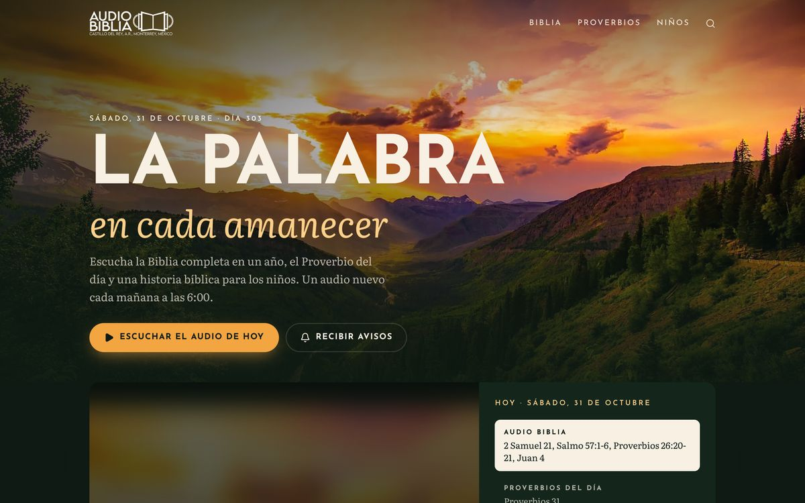

# Audio Biblias

Programa de la Mac que prepara cada día los audios del canal [AUDIO BIBLIAS](https://www.youtube.com/channel/UCJaQSWBy330FBq-bJTjzaPg) (Iglesia Montaña de Dios · Castillo del Rey, A.R.) y los deja **programados a las 6:00 a.m.** en YouTube y en 3 páginas de Facebook, más la página pública **https://audiobiblia.vercel.app** con su app, avisos y audio para escuchar con la pantalla apagada.

<p align="center">
  
</p>

| Parte | Dónde | Qué hace |
|---|---|---|
| **Programa `./ab`** | esta carpeta, en tu Mac | Elige el video de cada día, lo descarga, lo programa en YouTube y Facebook, sube el audio y avisa a la página |
| **Página y app** | [`web/`](web/README.md) → Vercel | Audios del día, archivo del año, lectura RV1909, buscador, progreso, avisos, PWA · [ver capturas](web/README.md) |

## Qué video toca cada día

| Serie | Regla |
|---|---|
| **Audio Biblia** | La lectura **siguiente** a la última que subiste (2 Samuel 20 → 2 Samuel 21…), siguiendo el mismo plan de lectura (Salmo y libro del Nuevo Testamento). El número de día del canal no se usa porque el mismo plan se ha subido varias veces con números distintos. Se publica como "Día N" con el día del año menos uno (`ajuste_dia: -1`). |
| **Proverbios** | Proverbios *N*, donde *N* es el día del mes (3 de nov → Proverbios 3). Versión más reciente. |
| **Niños** | Audio Biblia Niños Día *N* (día del año − 1). Siempre la versión **más reciente** (las viejas tenían errores de edición). |

## Uso

La corrida automática diaria está **desactivada**; se programa a mano cuando quieras:

```bash
./ab plan --semana            # muestra qué se publicaría (no sube nada)
./ab programar --semana       # programa 7 días desde mañana en YouTube y Facebook y avisa a la página
./ab programar --mes          # 30 días
./ab programar --desde 2026-11-12 --dias 3
./ab web-sync                 # sube los audios (pantalla apagada) y actualiza el archivo del año en la página
./ab estado                   # qué está programado y dónde
./ab panel                    # calendario en el navegador: lo pendiente y lo ya programado
```

**Recomendado después de programar:** `./ab web-sync`, para que esos días también tengan audio en la página (programar solo envía el calendario).

- `programar` se puede repetir sin miedo: recuerda lo que ya subió (en `data/estado.json`) y solo completa lo que falte. Con `--solo youtube|facebook` hace solo una plataforma; con `--sin-web` no avisa a la página; con `--ahora`, si la hora de un día ya pasó, lo publica de inmediato.
- Lo programado se publica a las 6:00 **aunque la Mac esté apagada**. Antes de un viaje, `./ab programar --mes` y `./ab web-sync` dejan un mes listo (Facebook acepta hasta 28 días adelante).

### La última Audio Biblia

Se detecta sola: es la más reciente publicada en tu canal (`./ab ultima-biblia` te dice cuál). Si necesitas corregirla, por ejemplo porque subiste una a mano:

```bash
./ab ultima-biblia "2 Samuel 20"
```

Basta con el capítulo; si varias lecturas empiezan igual (el canal ha usado más de un plan), elige la del plan actual.

### Videos mal titulados

`./ab plan` avisa con ⚠ cuando la Biblia se brinca un capítulo. Casi siempre es un video del canal con el título equivocado o que falta. Para corregirlo sin tocar YouTube, agrega su ID y el título correcto en [data/correcciones.yaml](data/correcciones.yaml).

### Corrida automática (opcional)

```bash
./scripts/instalar_automatico.sh            # todos los días a las 7:00 y al iniciar sesión
./scripts/instalar_automatico.sh --quitar
```

Hace `./ab programar --dias 14`, `./ab web-sync` y actualiza el panel; bitácora en `data/logs/`. El proyecto debe estar **fuera de Documentos, Escritorio y Descargas** (macOS no deja que las tareas automáticas lean esas carpetas). Hoy está desactivada.

## Límites y problemas conocidos

- **YouTube · cuota de la API**: hay un tope diario (Google Cloud → APIs → YouTube Data API v3 → Cuotas). Se suben hasta `max_subidas_por_corrida` (30) por corrida; si se acaba, lo que falte se sube en la siguiente. Se puede pedir más cuota gratis (formulario "YouTube API Services – Audit and Quota Extension").
- **YouTube · "confirma que no eres un bot"**: si se descargan muchos videos seguidos, YouTube bloquea las descargas unas horas. El programa no se cae: sigue con lo que ya tiene y lo demás lo intenta después. Hay pausas de 8–25 s entre descargas; si se repite seguido, pon `cookies_navegador: chrome` (o `safari`) en `config.yaml`.
- **Facebook**: solo se programa hasta 28 días adelante.
- **Audios**: se guardan los de los últimos 30 días en Vercel Blob (1 GB y ~10 GB de descargas al mes gratis). Si un mes se llena, la página usa YouTube automáticamente. Si crece mucho la audiencia, conviene pasarlos a Cloudflare R2.
- **Node**: el subidor de audios necesita Node 18 o más nuevo; lo busca solo en `~/.nvm` aunque el `node` por defecto sea viejo.

## Configuración (una sola vez)

Ya está hecha. Si hubiera que repetirla en otra Mac:

1. **Programa**: `python3 -m venv .venv && .venv/bin/pip install -r requirements.txt`, `cp config.example.yaml config.yaml`.
2. **YouTube**: proyecto en [Google Cloud](https://console.cloud.google.com/) con **YouTube Data API v3**, pantalla de consentimiento **Externa** y **publicada** (si se queda en "Prueba" el permiso caduca cada 7 días), credencial **App de escritorio** guardada como `credenciales/youtube_client_secret.json`, y luego `./ab auth-youtube`.
3. **Facebook (3 páginas)**: app en [developers.facebook.com](https://developers.facebook.com/apps) con el caso de uso **Administrar todo en tu página** y los permisos `pages_show_list`, `pages_read_engagement` y `pages_manage_posts`; token desde el [Explorador de la API Graph](https://developers.facebook.com/tools/explorer/) marcando las 3 páginas, y luego `./ab auth-facebook` (pide ID y clave de la app la primera vez; guarda tokens de página que no caducan).
4. **Página**: ver [web/README.md](web/README.md). La Mac necesita `web.url` en `config.yaml`, `credenciales/web_token.txt` (igual a `SYNC_TOKEN` en Vercel) y `credenciales/blob_token.txt` (Vercel Blob).
5. **Texto bíblico**: `python3 -I scripts/preparar_biblia.py descargas_drive/biblia/SpaRV.json` regenera `web/data/rv1909/` (Reina-Valera 1909, dominio público, de [scrollmapper/bible_databases](https://github.com/scrollmapper/bible_databases)).

## Estructura

```
ab                        atajo: ./ab <comando>
config.yaml               horario, plantillas de títulos y descripciones, opciones (no se sube a GitHub)
audiobiblias/
  catalogo.py             lista del canal y clasificación de títulos
  seleccion.py            qué video toca cada día (plan de lectura, saltos de capítulo)
  descarga.py             yt-dlp (mp4 H.264, máx. 1080p) con pausas y manejo de bloqueos
  youtube.py · facebook.py  subida programada
  audio.py                audios AAC 48 kbps → Vercel Blob (borra los de más de 30 días)
  web.py                  calendario y archivo del año → página (/api/sync)
  panel.py                panel local (./ab panel)
  cli.py                  comandos
scripts/                  corrida diaria, instalador de launchd, preparar_biblia.py
data/                     catálogo, estado, correcciones y bitácoras
credenciales/             tokens y claves (no compartir, no se sube a GitHub)
web/                      página y app (Next.js en Vercel) → web/README.md
```
